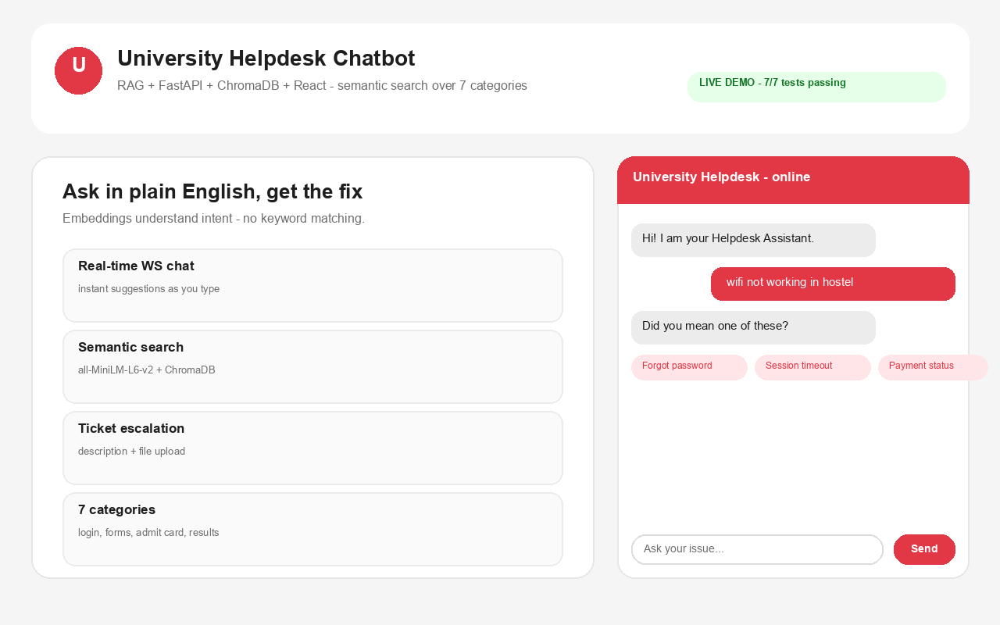
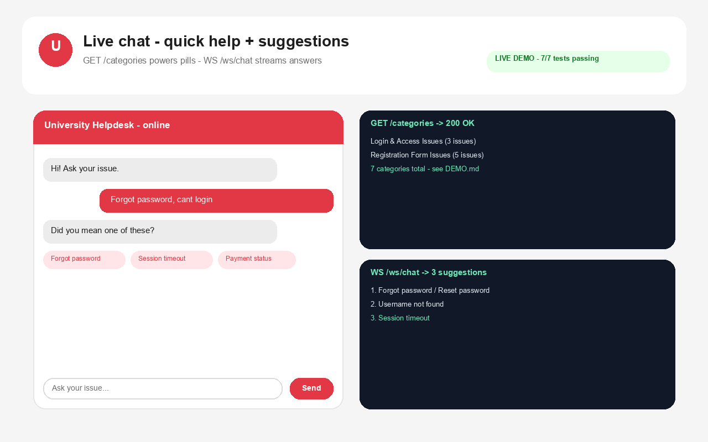
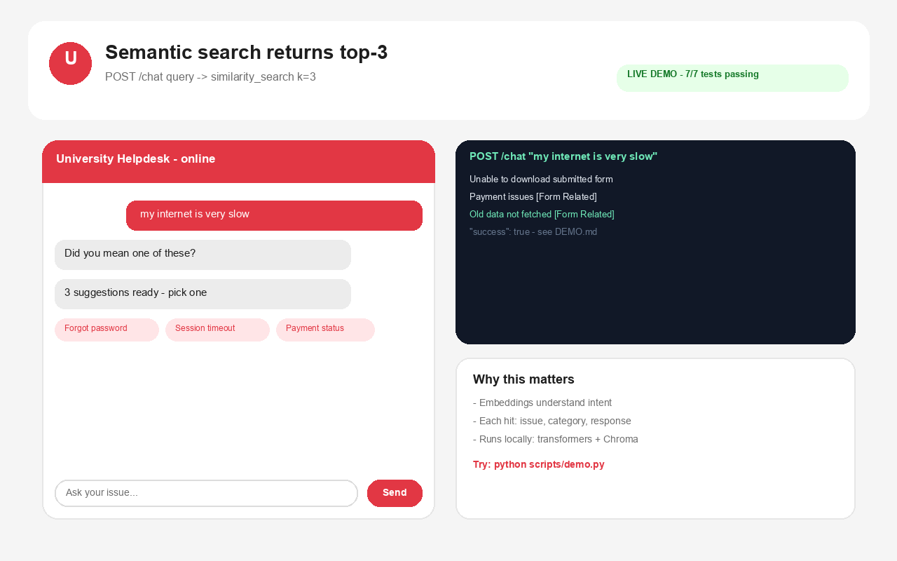
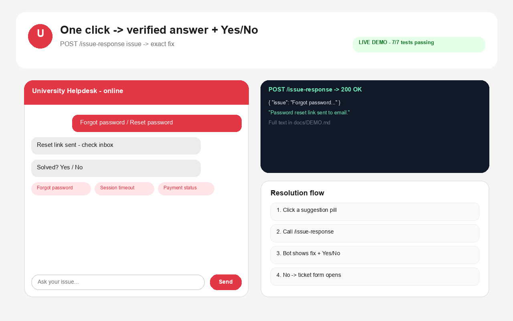
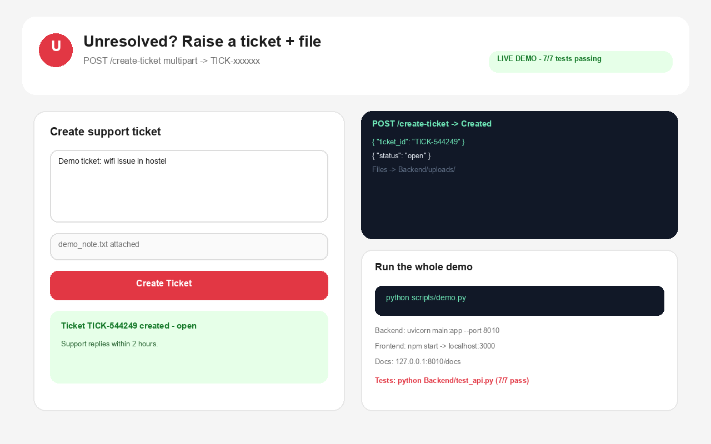

# University Helpdesk Chatbot — RAG + Real-Time Chat

A full-stack helpdesk chatbot that understands student queries with semantic search, returns instant fixes, and escalates to tickets with attachments when needed.



**Live right now:** Backend `http://127.0.0.1:8010` · Frontend `http://localhost:3000` · Docs `http://127.0.0.1:8010/docs` — 7/7 API tests passing.

## Demo — what everyone sees on Git

| Step | Preview |
|------|---------|
| 1. Landing — ask in plain English |  |
| 2. Live chat + quick-help pills |  |
| 3. Semantic top-3 suggestions |  |
| 4. One-click answer + Yes/No |  |
| 5. Ticket with attachment |  |

Full machine transcript: [docs/DEMO.md](docs/DEMO.md) — generated by `python scripts/demo.py` against the live backend.

```jsonc
// POST /chat  { "query": "wifi not working in hostel" }
{ "success": true, "suggestions": [
  { "issue": "Exam centre unreachable", "category": "Emergency / Time-Sensitive Issues" },
  { "issue": "Registration form not opening", "category": "Registration Form Issues" },
  { "issue": "Error: No User Found", "category": "Registration Form Issues" } ] }
```

## Features
- Real-time chat over WebSocket `/ws/chat` + REST fallback `/chat`
- Semantic search: `sentence-transformers/all-MiniLM-L6-v2` + ChromaDB `similarity_search(k=3)`
- Quick-help categories from `GET /categories` (7 categories in sample CSV)
- One-click answer via `POST /issue-response`, Yes/No resolution flow
- Ticket escalation `POST /create-ticket` with file upload to `Backend/uploads/`
- React widget UI (chat bubble, typing dots, localStorage history, refresh)
- Automated tests: `Backend/test_api.py` covers health, categories, chat, issue-response, tickets x2, websocket

## Tech stack
Frontend: React 19, MUI icons, WebSocket client · Backend: FastAPI, Uvicorn, Pydantic · AI: LangChain, HuggingFace `all-MiniLM-L6-v2`, ChromaDB · Data: Pandas, JSON, CSV

## Run it (2 terminals)
### Backend — port 8010
```bash
cd Backend
python -m venv venv
# Windows: venv\Scripts\activate  |  Mac/Linux: source venv/bin/activate
pip install -r ../requirements.txt
uvicorn main:app --host 127.0.0.1 --port 8010
# docs: http://127.0.0.1:8010/docs
```
> Port 8000 is often taken — this repo standardises on **8010**. Frontend defaults to 8010 too (`REACT_APP_API_URL` / `REACT_APP_WS_URL` override it).

### Frontend — port 3000
```bash
cd frontend
npm install
npm start
# open http://localhost:3000 — click the red chat bubble
```

### Verify + demo (backend running)
```bash
python Backend/test_api.py
# 7/7 tests passed
python scripts/demo.py
# writes docs/DEMO.md + prints live transcript
python scripts/make_screenshots.py
# regenerates docs/*.png (1280x800)
```

## API
| Method | Route | Body | Returns |
|--------|-------|------|---------|
| GET | `/` | — | `{ status, service }` |
| GET | `/categories` | — | `[{ category, issues[] }]` |
| POST | `/chat` | `{ query }` | `{ success, suggestions[3]: { issue, category, response } }` |
| POST | `/issue-response` | `{ issue }` | `{ success, response }` |
| POST | `/create-ticket` | `form: description + file?` | `{ success, ticket: { ticket_id, status, description, attachment } }` |
| WS | `/ws/chat` | text query | `{ success, suggestions[3] }` |

## Project structure
```text
university-helpdesk-ai/
├── Backend/
│   ├── main.py                  # entrypoint (persistent Chroma) — use this
│   ├── app.py                   # alternate entrypoint (in-memory Chroma)
│   ├── chatbot.py               # CSV → docs → embeddings → search_query()
│   ├── test_api.py              # 7 end-to-end tests
│   ├── alu_query_categories.csv # sample KB (7 categories)
│   └── uploads/                 # ticket attachments (gitignored)
├── frontend/src/App.js          # chat widget (API_URL defaults to :8010)
├── scripts/demo.py              # live demo → docs/DEMO.md
├── scripts/make_screenshots.py  # regenerates docs/*.png
├── docs/                        # demo screenshots + transcript (committed)
├── requirements.txt
└── README.md
```

## How it works
1. CSV rows → LangChain `Document(page_content=issue, metadata={category, issue, response})`
2. `HuggingFaceEmbeddings(all-MiniLM-L6-v2)` → Chroma `similarity_search(query, k=3)`
3. Frontend renders 3 pills → click → `/issue-response` → fix + Yes/No
4. No → ticket form → `POST /create-ticket` → `TICK-xxxxxx`

## Future scope
Embeddable widget · Postgres tickets · auth + admin dashboard · chat memory · RAG eval metrics · multi-university KBs · Docker + cloud deploy

## Author
**Devyash Kulshrestha** — B.Tech CSE (AI & Data Science) · https://github.com/devyash0010/university-helpdesk-ai

